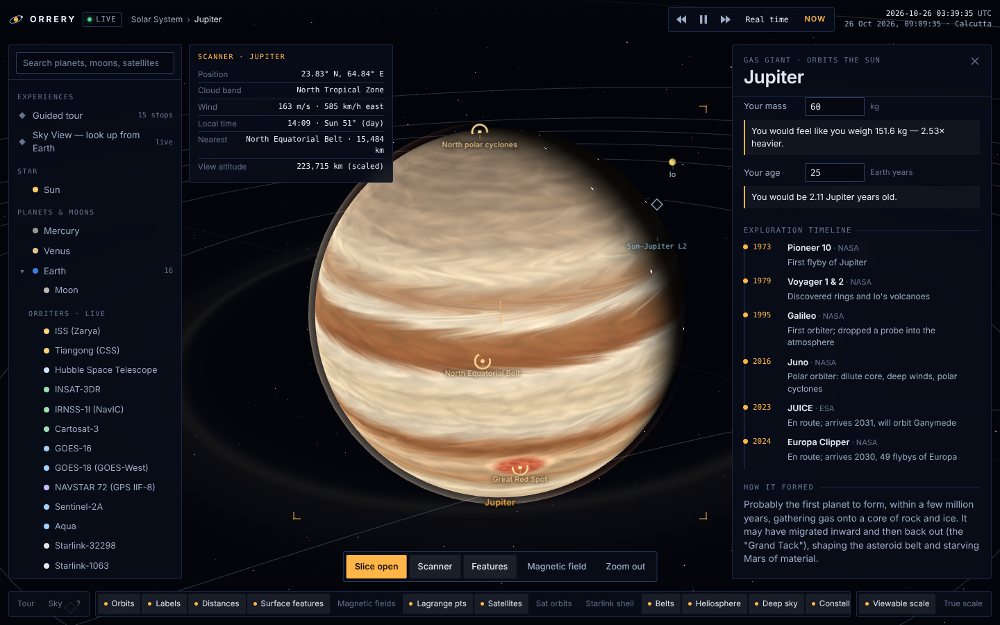
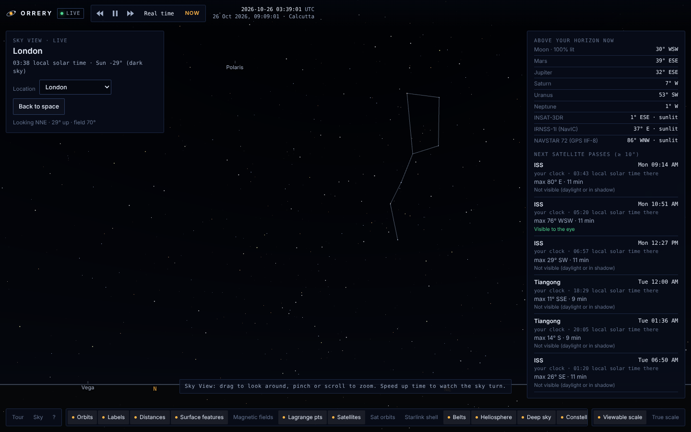

# Orrery Live

**An interactive 3D map of the Solar System and nearby universe, showing where everything is right now.**

Planet, Moon and satellite positions are computed live in your browser from real orbital data. Zoom from the galaxy down to a single spacecraft, slice planets open to see their layers, stand anywhere on Earth and look up at tonight's sky, or run a black-hole simulation.

No install, no account, no server: it is one HTML file.



---

## What you can do

| | |
|---|---|
| **Live Solar System** | All planets placed from JPL orbital elements for the current moment; speed time up, reverse it, or jump back to *now*. |
| **Earth in real time** | True day–night line, Moon position and phase, 13 real satellites (ISS, Tiangong, Hubble, INSAT-3DR, NavIC, GOES, GPS, Starlink…) propagated with SGP4, with ground tracks. |
| **Realistic spacecraft** | 3D models built from each spacecraft's real layout, with solar arrays that track the Sun. |
| **Sky View** | Pick any place on Earth and see the live sky: Sun, Moon, planets, stars, constellations and satellites crossing overhead. |
| **Pass predictions** | When the ISS, Tiangong and Hubble will next pass over a location, and whether they will be visible to the eye. |
| **Slice planets open** | Wedge or half cut-aways with labelled interior layers (Earth, Moon, Mars, Sun, giants). |
| **Surface scanner** | Aim at any world for latitude/longitude, local solar time, sunlight, cloud band and wind speed, and the nearest named feature. |
| **~70 surface features** | Everest, Mariana Trench, Apollo 11 and Chandrayaan-3 landing sites, Olympus Mons, the Great Red Spot and more. |
| **Magnetic fields** | Field lines, Earth's Van Allen belts, auroras and Io's plasma torus. |
| **Deep space** | Stars, black holes, supernova remnants, nebulae and galaxies in their true sky directions. |
| **Simulations** | Milky Way × Andromeda merger, black-hole gravity sandbox, Betelgeuse supernova. |
| **Guided tour** | 15 narrated stops from the Sun to Andromeda. |
| **Light signal** | Watch light travel from Earth to any object, with the real delay. |



## Try it locally

Open `dist/index.html` in any modern browser (Chrome, Edge, Firefox, Safari). That's it.

> Opened straight from disk, the page uses the satellite orbits built into it. When it is served from a website, it also loads `data/tle.json`, which the deploy job refreshes daily.

## Publish it as a website

### Option A: GitHub Pages (free, auto-updating)

1. Create a new public repository on GitHub and upload this folder (or `git push` it).
2. In the repository, go to **Settings → Pages** and set **Source** to **GitHub Actions**.
3. Push to `main`. The workflow in `.github/workflows/deploy.yml` builds the site and publishes it at `https://<your-username>.github.io/<repo-name>/`.

The same workflow runs every day to fetch fresh satellite orbits from CelesTrak, so the satellites stay accurate without anyone touching the code.

### Option B: Netlify Drop (fastest, no account setup beyond sign-in)

Drag the `dist` folder onto <https://app.netlify.com/drop>. You get a public URL in seconds. (Satellite orbits won't auto-refresh unless you also connect the repository.)

### Option C: Cloudflare Pages / Vercel

Connect the repository, set the build command to `python3 build.py` and the output directory to `dist`.

### Custom domain

All three hosts let you attach your own domain (for example `orrery.yourdomain.com`) from their settings.

## Build from source

Requires only Python 3, no packages.

```bash
python3 build.py                 # writes dist/index.html
python3 scripts/update_tle.py    # optional: refresh satellite orbits into data/tle.json
```

### Project layout

```
src/
  page.html      page shell, styles and HUD markup
  data.js        planets, moons, satellites (TLEs), deep-sky catalogue
  astro.js       ephemerides, coordinate frames, scale mapping
  surfaces.js    procedural planet surfaces from real geography
  textures.js    noise, palettes, ring and glow textures
  shaders.js     GLSL: Sun, gas giants, Earth, clouds, rings, interiors, black holes
  satmodels.js   procedural spacecraft models
  scene.js       Sun, planets, moons, Earth orbiters, belts, comet, probes
  deep.js        stars, black holes, nebulae, galaxies
  explore.js     surface features, scanner, magnetic fields, Lagrange points
  skyview.js     planetarium view and satellite pass prediction
  info.js        exploration history, facts, calculators
  sims.js        merger, gravity sandbox, supernova
  tour.js        guided tour and light-signal animation
  ui.js          panels, labels, picking, time controls
  controls.js    touch/mouse camera
  main.js        boot and frame loop
data/            country outlines (Natural Earth via world-atlas), satellite TLEs
scripts/         update_tle.py
```

## How accurate is it?

| Shown live and computed | Modelled from published measurements |
|---|---|
| Planet positions (JPL approximate elements, valid 1800–2050) | Planet interiors and convection |
| Moon position and phase; Galilean moon positions | Cloud motion (driven by measured wind profiles) |
| Satellite positions (SGP4 from NORAD TLEs) | Earth's clouds and city lights |
| Day–night line, subsolar point, seasons | Magnetic fields (dipole models) |
| Satellite passes and visibility | Deep-sky object shapes |

Distances are compressed so everything fits on screen (a *True scale* toggle is included), and objects are magnified to be visible. This is an educational tool, not for navigation or mission planning.

## Contributing

Issues and pull requests are welcome. Good first contributions:

- Add a satellite: append its NORAD number to `scripts/update_tle.py` and an entry to `O.SATS` in `src/data.js`.
- Add a surface feature: append to `O.POIS` in `src/explore.js` (latitude, east longitude, description).
- Translate the interface, improve accessibility, or add a Sky View from Mars.

Please cite a source for any new fact.

## Credits

- **three.js** (MIT), **satellite.js** (MIT), **topojson-client** (ISC): see `licenses/`.
- Country and land outlines: **Natural Earth** (public domain) via **world-atlas** (ISC).
- Satellite orbital elements: **CelesTrak**, from US Space Force data.
- Planetary data: **NASA** Planetary Fact Sheet; orbital elements from E. M. Standish, *Approximate Positions of the Planets* (JPL); lunar and Galilean-moon theory after J. Meeus, *Astronomical Algorithms*.
- Fonts: **Inter Tight** and **IBM Plex Mono** (SIL Open Font License) via Google Fonts.

## License

[MIT](LICENSE)
